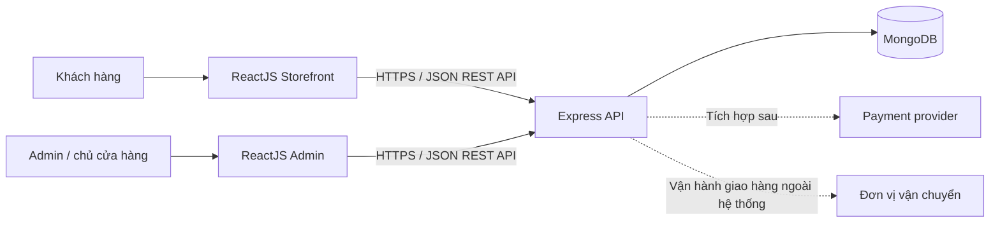
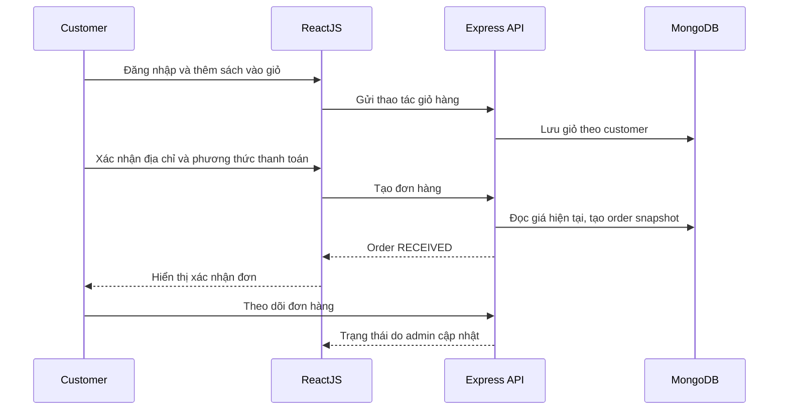

# System Design

Tài liệu tổng quan kiến trúc và phạm vi MVP của nền tảng mua bán sách. Đây là baseline để bắt đầu triển khai; các quyết định còn mở được ghi rõ trong từng tài liệu thiết kế và sẽ được cập nhật sau các vòng brainstorm nghiệp vụ.

## 1. Mục tiêu và phạm vi

Xây dựng web app fullstack cho doanh nghiệp phân phối sách, với hai actor trong MVP: khách hàng và quản trị viên/chủ cửa hàng. Khách hàng duyệt sách, quản lý giỏ hàng, đặt đơn và theo dõi đơn; admin quản lý catalog và xử lý đơn hàng.

MVP yêu cầu khách hàng đăng nhập trước khi đặt hàng. Thông tin giao hàng được lưu để tự điền ở lần đặt sau. Có hai phương thức thanh toán: COD và thanh toán trước. Tích hợp nhà cung cấp thanh toán cụ thể chưa được chọn.

MVP chưa quản lý số lượng tồn kho, chưa giữ hàng và chưa kiểm tra khả năng đáp ứng tồn kho khi đặt đơn. Không được hiểu việc đơn hàng được tạo là xác nhận còn hàng.

## 2. Stack và kiến trúc

- Frontend: ReactJS.
- Backend: Node.js và ExpressJS, cung cấp REST API.
- Database: MongoDB.
- Triển khai: chưa chọn nền tảng; thiết kế cần hỗ trợ tách cấu hình theo môi trường và deploy frontend/backend độc lập khi cần.

Trong MVP, quản trị giao hàng và cập nhật trạng thái do admin thực hiện thủ công. Carrier không phải actor đăng nhập hoặc tích hợp API ở thời điểm này.

## 3. Actor và quyền

| Actor | Quyền trong MVP |
|---|---|
| Guest | Xem danh mục và chi tiết sách; chưa thể tạo đơn |
| Customer | Đăng ký/đăng nhập, quản lý thông tin giao hàng, giỏ hàng, đặt đơn và xem đơn của chính mình |
| Admin | Quản lý sách/danh mục, xem và cập nhật trạng thái mọi đơn hàng |

Admin là chủ cửa hàng; chưa tách role nhân viên. API phải kiểm tra quyền ở backend, không dựa vào việc ẩn nút trên frontend.

## 4. Các quyết định nghiệp vụ baseline

### Catalog và tìm kiếm

Book có các thông tin cơ bản: tiêu đề, tác giả, nhà xuất bản, ISBN tùy chọn, mô tả, thể loại, giá, ảnh, trạng thái hiển thị và thời điểm tạo/cập nhật. Chưa hỗ trợ biến thể/ấn bản theo SKU, khuyến mãi hay giá theo thời gian.

Trong MVP, frontend tải tập sách cần hiển thị rồi lọc theo từ khóa khi người dùng nhập (`onChange`). Không triển khai full-text search. Với dataset lớn, cần chuyển sang tìm kiếm/phân trang phía server thay vì tải toàn bộ catalog.

### Đơn hàng

Đơn hàng giữ snapshot tên sách, giá và số lượng tại thời điểm đặt để lịch sử không đổi khi catalog được sửa. Admin là actor duy nhất được phép chuyển trạng thái sau khi đơn được tạo.

Trạng thái giao vận và trạng thái thanh toán là hai thuộc tính riêng. Trạng thái giao vận dự kiến: `RECEIVED`, `CONFIRMED`, `HANDED_TO_CARRIER`, `IN_TRANSIT`, `DELIVERED`, `CANCELLED`. `DELIVERED` và `CANCELLED` được thêm để kết thúc vòng đời thực tế; quy tắc hủy và xử lý sau giao cần được xác nhận trước production.

Phương thức thanh toán: `COD` hoặc `PREPAID`. Với trả trước, MVP có thể lưu lựa chọn và trạng thái thanh toán; việc xác nhận thanh toán tự động phụ thuộc provider/webhook chưa lựa chọn. Không đánh dấu đã thanh toán dựa trên redirect từ trình duyệt.

### Giỏ hàng và hồ sơ giao hàng

Giỏ hàng gắn với customer đã đăng nhập và được lưu server-side để dùng trên nhiều phiên. Hồ sơ customer có địa chỉ giao hàng mặc định; đơn hàng lưu snapshot địa chỉ nhận hàng để thay đổi hồ sơ không sửa đơn cũ.

## 5. Ranh giới hệ thống

Trong phạm vi MVP: storefront, admin UI, xác thực, catalog, giỏ hàng, đặt đơn, lịch sử đơn, cập nhật trạng thái, lưu lựa chọn/phương thức thanh toán.

Chưa nằm trong MVP: quản lý tồn kho và reservation, cổng thanh toán cụ thể, refund/chargeback/reconciliation, tích hợp vận chuyển/tracking, hóa đơn/kế toán, notification bên ngoài, khuyến mãi, tax/shipping fee phức tạp.

## 6. Luồng mua hàng

API phải tính tổng tiền từ dữ liệu catalog phía server, không tin giá/tổng tiền do frontend gửi. Do MVP chưa quản lý tồn kho, đơn được tiếp nhận chưa đảm bảo khả năng cung ứng.

## 7. Các tài liệu chi tiết

- [Domain model và MongoDB schema](DomainModel.md): collection, field, quan hệ, index và consistency.
- [API contract và error model](APIContract.md): endpoint, payload, response và quy ước lỗi.
- [Authentication và authorization](Authentication.md): session/token, bảo vệ tài khoản và phân quyền.
- [Order lifecycle](OrderLifecycle.md): state machine đơn hàng và trạng thái thanh toán.
- [Inventory design](InventoryDesign.md): phạm vi chưa làm trong MVP và hướng mở rộng an toàn.
- [Payment integration](PaymentIntegration.md): boundary cho COD/trả trước và provider tương lai.
- [Deployment và observability](DeploymentObservability.md): môi trường, cấu hình, logging, metrics và backup.
- [Frontend design](client/FrontendDesign.md): routes, modules, data flow và UI states.
- [Figma UI/UX handoff](client/FigmaDesign.md): design system, frames, screens và prototype flows.
- [Figma import SVG](client/design/BookStore-Figma-Import.svg): visual boards desktop/mobile có thể import vào Figma.
- [Backend design](server/BackendDesign.md): module boundaries, folder structure, middleware, persistence và service flow.

## 8. Các quyết định cần xác nhận trước production

1. Provider thanh toán trả trước, phương thức thanh toán được hỗ trợ và quy trình đối soát.
2. Chính sách hủy đơn theo từng trạng thái; ai xử lý đơn giao thất bại/hoàn hàng.
3. Có tính phí vận chuyển, thuế, giảm giá hoặc giới hạn khu vực giao hàng không.
4. Trường thông tin customer bắt buộc, nhiều địa chỉ và cách xác minh email/số điện thoại.
5. Chính sách hết hàng khi chưa có inventory tracking và cách admin xác nhận khả năng cung ứng.
6. Giới hạn catalog để chọn thời điểm chuyển từ lọc client-side sang phân trang/tìm kiếm server-side.
7. Hosting, domain, region, ngân sách, mục tiêu uptime và thời gian lưu backup/log.

Các lựa chọn trong tài liệu này là baseline thiết kế, không thay thế yêu cầu pháp lý hoặc xác nhận nghiệp vụ trước khi mở bán thật.
