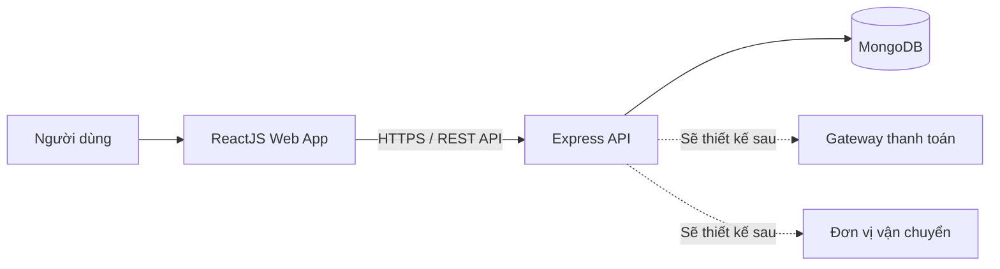
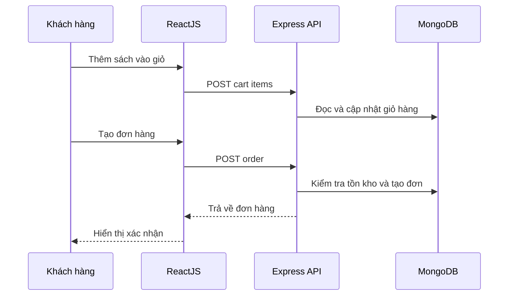

# System Design - Tạm thời

Tài liệu này là khung thiết kế ban đầu cho nền tảng quản lý mua bán sách. Nội dung cần được bổ sung và điều chỉnh trong các buổi brainstorm về nghiệp vụ.

## 1. Tổng quan

Hệ thống là một web fullstack sử dụng ReactJS cho giao diện, Express cho API và MongoDB để lưu trữ dữ liệu. Mục tiêu ban đầu là hỗ trợ các quy trình kinh doanh lõi của cửa hàng sách: quản lý sản phẩm, quản lý tồn kho, đặt hàng và xử lý đơn hàng.

Các hệ thống thanh toán bên ngoài chưa được thiết kế chi tiết ở giai đoạn này. Tài liệu sẽ thêm actor, integration boundary và luồng thanh toán sau khi phạm vi nghiệp vụ được thống nhất.

## 2. Kiến trúc mức cao



### Frontend

ReactJS chịu trách nhiệm hiển thị giao diện, điều hướng, quản lý state phía client và gọi API đến backend. Các khu vực chức năng dự kiến gồm:

- Trang cửa hàng và danh mục sách.
- Tìm kiếm, lọc và xem chi tiết sản phẩm.
- Giỏ hàng và quy trình đặt hàng.
- Quản lý tài khoản và đơn hàng cá nhân.
- Trang quản trị cho sách, tồn kho và đơn hàng.

### Backend

Express cung cấp REST API, xác thực người dùng, business logic và kiểm soát truy cập. Backend nên được tổ chức theo miền nghiệp vụ thay vì gom toàn bộ logic vào một lớp route duy nhất.

### Database

MongoDB lưu trữ dữ liệu nghiệp vụ theo document. Các collection cụ thể và quan hệ giữa dữ liệu cần được xác nhận qua brainstorm trước khi cài đặt.

## 3. Các miền nghiệp vụ cần brainstorm

### Catalog

- Cấu trúc thông tin sách: tên, tác giả, nhà xuất bản, ISBN, mô tả, thể loại và giá.
- Giá bán, giá khuyến mãi và phiên bản sách được mô hình hóa thế nào?
- Một đầu sách có thể có nhiều định dạng hoặc nhiều bản in không?
- Quy tắc tìm kiếm, lọc và phân loại danh mục.

### Inventory

- Tồn kho được theo dõi theo đầu sách hay theo từng SKU/phiên bản cụ thể?
- Khi nào tồn kho được giữ, giảm hoặc hoàn lại?
- Quy tắc xử lý hết hàng, đặt trước và nhập hàng.
- Ai có quyền điều chỉnh tồn kho và cần lưu lịch sử thay đổi không?

### Order

- Khách hàng có cần tài khoản để đặt hàng không?
- Giỏ hàng được lưu ở client, server hay cả hai?
- Trạng thái đơn hàng ban đầu dự kiến: pending, confirmed, processing, shipped, completed, cancelled và các trạng thái khác?
- Ai được phép thay đổi trạng thái và quy tắc chuyển đổi trạng thái.

### Customer and Identity

- Phương thức đăng ký, đăng nhập và khôi phục tài khoản.
- Mô hình vai trò: customer, admin, staff hoặc vai trò chi tiết hơn.
- Thông tin cần lưu cho địa chỉ giao hàng và lịch sử đơn hàng.

### Promotion

- Cần hỗ trợ khuyến mãi, mã giảm giá hoặc chương trình thành viên không?
- Quy tắc áp dụng và điều kiện ưu tiên cần xác định trước khi thiết kế model.

## 4. Actor và quyền truy cập

| Actor | Quyền nghiệp vụ dự kiến |
|---|---|
| Guest / customer chưa đăng nhập | Xem sách, tìm kiếm, tạo giỏ hàng |
| Customer | Quản lý tài khoản, đặt hàng và theo dõi đơn hàng |
| Staff | Xử lý đơn hàng và cập nhật thông tin vận hành khi nghiệp vụ được xác nhận |
| Admin | Quản lý sách, tồn kho, đơn hàng, người dùng và cấu hình cửa hàng |

Danh sách actor và phân quyền phải được xác nhận trong quá trình brainstorm.

## 5. Data model tạm thời

Các entity dưới đây là điểm khởi đầu, không phải quyết định cuối cùng:

- `User`
- `Book`
- `Category`
- `Inventory`
- `Cart`
- `CartItem`
- `Order`
- `OrderItem`
- `Address`

Các field, quan hệ, index và quy tắc ràng buộc sẽ được cập nhật sau khi luồng nghiệp vụ rõ hơn.

## 6. API tạm thời

Định hướng API nhóm theo miền nghiệp vụ:

```text
/auth
/books
/categories
/cart
/orders
/inventory
/admin
```

Cấu trúc endpoint cụ thể, phương thức xác thực, status code và response schema chưa được cố định.

## 7. Luồng đặt hàng ban đầu



Luồng thanh toán có thể thay đổi hoàn toàn sau khi lựa chọn cổng thanh toán hoặc quy trình thanh toán ngoài.

## 8. Phạm vi loại trừ tạm thời

Ở tài liệu này chưa chốt:

- Payment gateway và settlement.
- Refund, chargeback và reconciliation.
- Cổng vận chuyển hoặc tracking provider.
- Hóa đơn và quy định kế toán.
- Tax, shipping fee và policy chi tiết.
- Notification qua SMS/email/push.
- Hosting, domain, CI/CD và infrastructure cụ thể.

Các mục trên cần được đưa vào brainstorm riêng thay vì mặc định chốt sớm.

## 9. Điểm cần quyết định trước khi triển khai

1. MVP cần phục vụ khách hàng, nhân viên hay quản trị viên là chính?
2. Quy trình đặt hàng có cần thanh toán trả trước hay có thể thanh toán sau?
3. Model sách và tồn kho sử dụng cách tổ chức nào?
4. Trạng thái đơn hàng và quyền chuyển trạng thái là gì?
5. Khách hàng có bắt buộc đăng nhập không?
6. Quản trị viên thao tác tồn kho như thế nào?
7. Cách triển khai tìm kiếm và lọc dữ liệu có cần full-text search không?
8. Số lượng môi trường, cách deploy và domain khi dự án chuyển sang production?

## 10. Mở rộng tiếp theo

Sau khi thống nhất các mục ở trên, tài liệu cần được hoàn thiện thêm về:

- Domain model và schema MongoDB chi tiết.
- API contract và error model.
- Authentication và authorization.
- State machine của đơn hàng.
- Inventory reservation và consistency model.
- Payment integration boundaries.
- Deployment architecture và observability.
- Testing strategy và security baseline.
