# Backend Design

Thiết kế ExpressJS theo module nghiệp vụ; một API deployable cho MVP, không tách microservices khi chưa có nhu cầu vận hành độc lập.

## Module boundaries

- `auth`: register/login/logout, session resolution, current user.
- `users`: profile và địa chỉ mặc định.
- `catalog`: books/categories, public query và admin mutations.
- `cart`: cart theo customer và quantity operations.
- `orders`: tạo order, ownership queries, admin queue/status transitions.
- `payments`: payment method/status và adapter boundary; provider adapter chưa triển khai.
- `shared`: config, database, validation, errors, logging, middleware.

Mỗi module có thể gồm router/controller, schema validation, service/use case và repository/model. Controller chuyển HTTP input/output; business rule nằm trong service, không nhồi vào router hoặc Mongoose hook khó quan sát.

## Thư mục backend

Cây dưới đây chỉ là khung phân chia source/test; hiện chưa chứa implementation:

```text
BE/
├── BackendDesign.md
├── src/
│   ├── config/                 # Environment và cấu hình service
│   ├── database/               # MongoDB connection và database setup
│   ├── middleware/             # Session, auth, role, request ID, error handling
│   ├── modules/
│   │   ├── auth/               # Register, login, logout, session
│   │   ├── users/              # Profile và địa chỉ mặc định
│   │   ├── catalog/            # Books, categories và admin catalog actions
│   │   ├── cart/               # Customer cart
│   │   ├── orders/             # Order creation, ownership, admin transitions
│   │   └── payments/           # COD/prepaid model và provider boundary
│   └── shared/
│       ├── errors/             # App errors và HTTP error mapping
│       ├── utils/              # Utilities dùng chung
│       └── validation/         # Shared validation helpers
└── tests/
    ├── unit/
    └── integration/
```

Các folder hiện được giữ bằng `.gitkeep`; chưa có source code, package setup hay lựa chọn framework phụ trợ. Khi bắt đầu coding, mỗi module có thể mở rộng thành `routes/`, `controllers/`, `services/`, `validators/`, `repositories/` và `models/` theo nhu cầu, không cần tạo sẵn những folder rỗng chưa dùng.

`admin` và `customer` không tách thành module riêng: đây là role/authorization áp dụng trên các miền `catalog`, `orders`, `users` và `cart`. Frontend mới tổ chức màn hình theo pages/components.

## Request pipeline

```mermaid
flowchart LR
    Request[HTTP request] --> Security[Security / CORS / rate limits]
    Security --> Parse[Request ID / parse / validate]
    Parse --> Session[Session authentication]
    Session --> Authorization[Role and ownership checks]
    Authorization --> Route[Controller]
    Route --> Service[Use case]
    Service --> Repository[MongoDB repository]
    Repository --> ErrorHandler[Central error mapper]
    ErrorHandler --> Response[JSON response]
```



Middleware thứ tự thực tế cần đảm bảo body size/CORS/security được áp dụng trước routes; error handler đặt cuối. Health endpoints không tiết lộ config hoặc lỗi nội bộ.

## Domain rules

### Catalog

- Validate field types, length, price >= 0, ISBN format nếu có, category references.
- Public query chỉ trả `isPublished=true`.
- Khi sửa/xóa danh mục hoặc sách, bảo toàn tham chiếu từ order snapshot.

### Cart và order

- Cart luôn scoped theo user ID từ session.
- Tạo order dùng cart server-side, đọc giá hiện hành, validate book publish status và tính tổng tại backend.
- Validate shipping address/payment method; persist snapshot và trạng thái khởi đầu `RECEIVED`.
- Dùng `Idempotency-Key` cho create order; lưu kết quả theo customer + key với TTL/retention được quyết định.
- Clear cart sau create order thành công; thiết kế retry để không tạo duplicate.
- Không kiểm tra/reserve inventory trong MVP; admin xác nhận cung ứng thủ công.

### Order transitions

Service nhận order ID, trạng thái mong muốn, actor admin và expected current status/version. Dùng atomic update có điều kiện, ghi history cùng update, trả `409 STATE_CONFLICT` nếu trạng thái đã đổi hoặc transition không hợp lệ.

## Persistence

MongoDB access qua models/repositories; index được khai báo rõ theo [DomainModel.md](../DomainModel.md). Validate dữ liệu ở API boundary; không xem schema validation tại database là thay thế cho business validation.

Dùng transaction khi một use case cần atomicity qua nhiều document và MongoDB chạy replica set. Nếu không bật transaction, thiết kế từng bước có idempotency/compensation rõ ràng; tránh cho rằng nhiều lệnh ghi là atomic cùng nhau.

## Security controls

- Session middleware và role/ownership guards phía server.
- Validation allowlist để ngăn mass assignment (`role`, payment status, totals, owner ID).
- Rate-limit login/register và các endpoint nhạy cảm.
- CORS allowlist, cookie/CSRF policy theo deployment.
- Giới hạn kích thước payload; chuẩn hóa lỗi không lộ stack trace.
- Secrets chỉ từ environment/secret manager; redact PII trong logs.

## Testing boundaries

- Unit test domain rules: totals, transition matrix, validation.
- Integration test với MongoDB test instance cho ownership, index/unique constraints, session and order creation/idempotency.
- API tests cho auth boundaries, customer không đọc đơn người khác, customer không gọi admin routes, stale transition trả conflict.
- Contract test hoặc schema checks để response giữ đúng API contract.

## Chưa chốt

Thư viện validation, ODM (ví dụ Mongoose hay native driver), session store, logging framework, API docs generator và upload/storage service nên được chọn khi bootstrap backend. Không chọn database transaction/session strategy trước khi xác định topology MongoDB thực tế.
